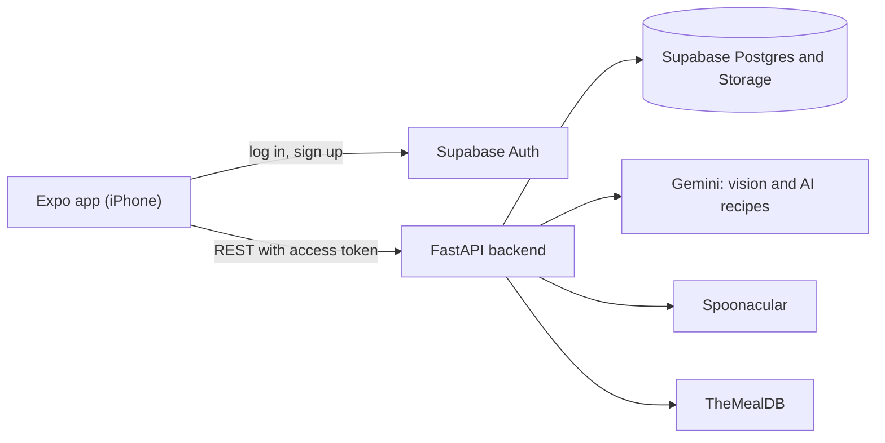

# Foodiez

Point your iPhone camera at the food you have, confirm the ingredients, and get recipes you can make right now.

See [BUILD_GUIDE.md](BUILD_GUIDE.md) for the product spec and build phases.

## Screenshots

_Coming soon._

## Architecture



API keys live only in the backend. The app talks to Supabase directly for auth, and everything else goes through the API.

A scan uploads photos to `/scan`, which returns detected ingredients for the user to confirm. `/recipes` then queries Chef's Picks and online sources in parallel, scores each result against what the user owns, and adds AI recipes when there are few good matches.

### Known limits

- Caches and rate limits live in server memory, so they reset on restart and apply per process. Multiple servers would need a shared store such as Redis.
- Spoonacular's terms cap caching at one hour and require prior written permission for it, and only allow storing a recipe's id, title and image url. Full details are fetched when a saved recipe is opened.
- The free Spoonacular quota suits a demo, not public traffic.

## Requirements

- Node 22.13 or newer (`nvm use` picks it up from `.nvmrc`)
- Python 3.11 or newer
- Expo Go on your iPhone, with the iPhone and laptop on the same Wi-Fi

## Set up the database

1. Create a Supabase project and copy its URL and keys into `backend/.env` and `mobile/.env`
2. In the Supabase SQL Editor, run `supabase/migrations/0001_initial_schema.sql`
3. Run `supabase/migrations/0002_query_indexes.sql` the same way
4. In Authentication, turn off **Confirm email** for local development
5. Load the seed data from `backend/` with `.venv/bin/python -m scripts.seed`, then `.venv/bin/python -m scripts.seed_feed` for sample feed posts

Replace the sample recipes in `seed/chef_picks.json` with your own, then run the seed script again.

## Run the backend

```sh
cd backend
python3.11 -m venv .venv
source .venv/bin/activate
pip install -r requirements.txt
cp .env.example .env   # add your keys and a RECIPE_SIGNING_SECRET
uvicorn app.main:app --host 0.0.0.0 --reload
```

Run the tests with `pytest` from `backend/`.

## Run the app

Find your laptop's local IP. On a Mac on Wi-Fi:

```sh
ipconfig getifaddr en0
```

Then:

```sh
cd mobile
npm install
cp .env.example .env   # set EXPO_PUBLIC_API_URL to http://<your-ip>:8000
npx expo start
```

Scan the QR code with the iPhone Camera app to open the project in Expo Go.

Your local IP can change when you switch networks. If the app stops connecting, check it again, update `mobile/.env`, and restart Expo.

## Troubleshooting

If Home cannot reach the backend:

1. Allow Local Network access for Expo Go in iPhone Settings
2. Allow incoming connections for Python in the macOS firewall
3. Open `http://<your-ip>:8000/health` in Safari on the iPhone to test the connection without the app
